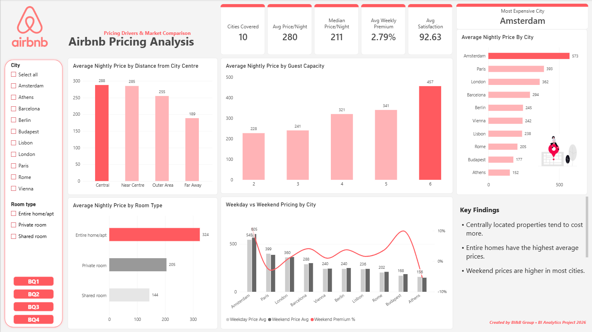
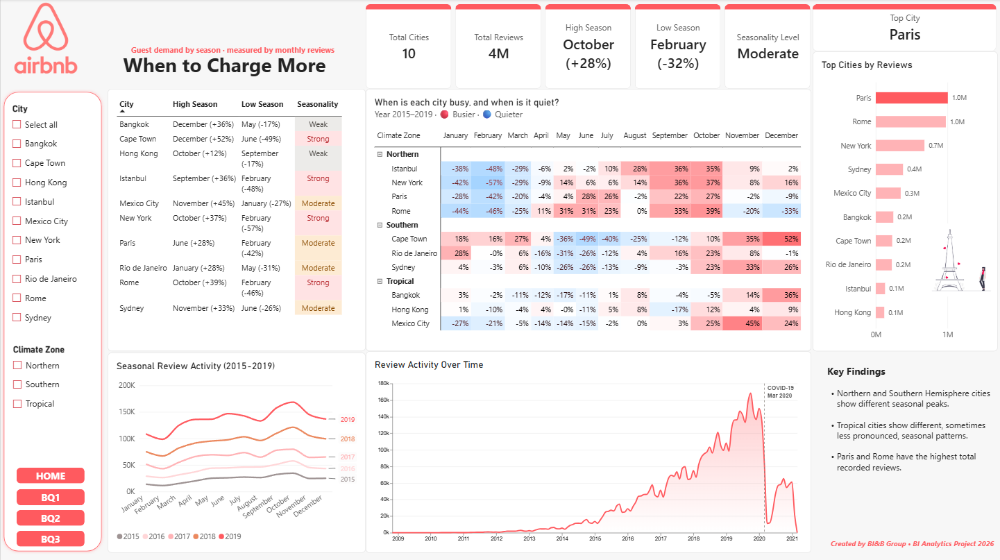

# Airbnb Pricing & Seasonality Analysis

**What drives the price of an Airbnb stay, and when should hosts charge more?**

A Power BI report that analyses nightly prices across 10 European cities and guest demand across 10 global cities, built by Team BI&B at Nackademin (BI26).


---

## Overview

Airbnb hosts need to set the right price, and the right price depends on location, property type and time of year. The report answers business questions in two areas:

1. **Pricing:** Which factors drive the nightly price, and how do cities compare?
2. **Seasonality:** When is each city busy, and when is it quiet?

Navigation buttons on each page lead to the visuals for each business question.

---

## Dashboards

### 1. Airbnb Pricing Analysis: pricing drivers and market comparison



| KPI | Value |
|---|---|
| Cities covered | 10 |
| Average price per night | 280 |
| Median price per night | 211 |
| Average weekend premium | 2.79% |
| Average guest satisfaction | 92.63 |
| Most expensive city | Amsterdam |

### 2. When to Charge More: guest demand by season



| KPI | Value |
|---|---|
| Cities covered | 10 |
| Total reviews | 4M |
| High season | October (+28%) |
| Low season | February (−32%) |
| Seasonality level | Moderate |
| Top city by reviews | Paris |

Demand is measured by the number of guest reviews per month, which works as a proxy for bookings.

---

## Key findings

**Pricing**
- **Central listings cost more.** They average 288 per night, compared with 189 for listings far from the centre, which is about 34% less.
- **Amsterdam is the most expensive city** at 573 per night, almost four times Athens (152).
- **Bigger listings cost more.** A listing for 6 guests averages 457, twice as much as one for 2 guests (228).
- **Entire homes cost the most** (324), followed by private rooms (205) and shared rooms (144).
- **Weekends cost slightly more in most cities** (+2.79% on average). Paris and Athens are exceptions, with lower weekend prices.

**Seasonality**
- **Demand peaks in October and is lowest in February** across all cities.
- **The hemisphere decides the high season.** Northern cities such as Paris, Rome and New York are busiest in September and October. Southern cities such as Cape Town and Sydney peak from November to January.
- **Tropical cities have weaker patterns.** Bangkok and Hong Kong show only weak seasonality.
- **Paris and Rome have the most reviews,** about 1 million each.
- **Reviews grew steadily until 2019**, then dropped sharply in March 2020 because of COVID-19.

**What this means for hosts:** raise prices for central, larger and entire-home listings, and plan price increases around each city's own high season rather than one global calendar.

---

## Data

| Page | Dataset | Coverage |
|---|---|---|
| Pricing analysis | [ADD DATASET NAME AND LINK] | 10 European cities: Amsterdam, Athens, Barcelona, Berlin, Budapest, Lisbon, London, Paris, Rome, Vienna |
| Seasonality | [ADD DATASET NAME AND LINK] | 10 global cities: Bangkok, Cape Town, Hong Kong, Istanbul, Mexico City, New York, Paris, Rio de Janeiro, Rome, Sydney, 2009–2021 |

---

## Tools and methods

- **Power Query:** data cleaning and preparation
- **DAX:** KPI measures such as average and median price, weekend premium and seasonal change
- **Power BI report design:** KPI cards, slicers for city, room type and climate zone, a monthly demand heatmap, a weekday vs weekend combo chart, and navigation buttons for each business question

---

## Limitations

- Reviews measure demand indirectly. Not every guest leaves a review.
- Prices are averages in the dataset's own currency.
- Data from 2020 onwards is affected by COVID-19, so seasonal patterns are based on 2015–2019.

---

## Repository structure

```
airbnb-pricing-powerbi/
├── README.md
├── images/
│   ├── 01-pricing-analysis.png
│   └── 02-seasonality.png
└── report/
    └── airbnb-pricing-analysis.pbix
```

---

## Team BI&B

Group project in the course *Systemförståelse och verksamhetsprocesser inom BI*, Business Intelligence Analyst programme (BI26), Nackademin, 2026.

- Chayanis Karlsson ([LinkedIn](https://www.linkedin.com/in/chayanis-k))
- Poonam
- Rekha
- Aasiya
- Rabbiya
- Munira
